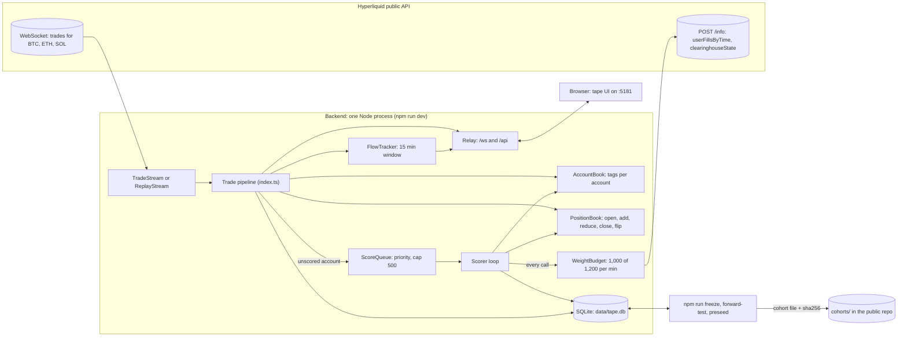

# Architecture

How Wallet-Labeled Tape fits together, what is built, what is left, and the order it gets built
in. Spec: `docs/PRD.md`. Who does what: `TASKS.md`. Codex prompts: `docs/CODEX_PROMPTS.md`.

## The shape

One Node process and one browser tab, on the demo laptop. Hyperliquid's free public API is the
only data source. No hosting, no keys, ₹0. Three helper scripts (freeze, forward test, pre-seed)
read and write the same SQLite file next to it.

## What happens to one trade

1. The stream gets a trade with `users: [buyer, seller]`.
2. For each side, the pipeline reads the account's tags from `AccountBook` (Pending if unscored)
   and asks `PositionBook` what the trade did: open, add, reduce, close or flip. Unscored accounts
   get "unknown", never a guess.
3. Unscored accounts over $5k go into `ScoreQueue`, priority = notional x recency.
4. `FlowTracker` records the signed exposure change for profitable accounts.
5. The row is saved to `trades` (kept 48 h) and pushed to the browser. Target: under 1 second.

## What happens to one account

1. The scorer pops the highest-priority account and pages `userFillsByTime` over the last 30
   days, 2,000 fills a page, stopping at the 10,000 reachable. Every page is charged to
   `WeightBudget` first: 20 base plus 1 per 20 fills returned, so a full page costs about 120.
2. **Early stop** (saves budget): if the newest 2,000 fills span under 24 hours, the 10,000 cap
   cannot reach 7 days of history, so the account is scored from that one page as Insufficient
   history. These are mostly bots and market makers, which otherwise eat 600 weight each.
3. Round trips are rebuilt per coin, metrics computed, tags assigned (all thresholds from
   `config.ts`), the row written to `accounts`, and `AccountBook` and `PositionBook` seeded.
4. Tags expire after 1 h (active cohort) or 6 h (others) and are re-queued at low priority with an
   incremental fetch from the last fill time.

**Throughput.** With 1,000 weight a minute, light accounts cost about 25 and full ones about 600,
so expect roughly 10 to 30 accounts scored a minute: 600 to 1,800 in the first hour. That is why
the demo laptop has to run for an hour or more before the freeze and before judging.

## The forward test (the proof slide)

The design keeps the test honest and keeps it off the critical path:

1. **Freeze (T0).** `npm run freeze` copies every scored account's tag and metrics, computed only
   from fills before T0, into `cohorts` and writes `cohorts/<id>.json` plus its sha256. Aarit
   commits and pushes that file, so GitHub's timestamp shows the cohort existed at T0 and was
   never edited. Thresholds are tuned **before** the freeze, never after.
2. **Measure later.** `npm run forward-test` fetches each cohort account's fills after T0 and
   turns every open or add (one per order id) into a signal. Entry = price 10 s after the signal
   (copy delay), exit = price 15, 60 and 240 minutes after that, minus a 9 bps round-trip taker
   fee. Prices come from our own `trades` table. Groups: Profitable cohort, Unprofitable cohort,
   a random size-matched cohort, and all flow. Market makers are left out of every group.
3. Because measurement reads fills after the fact, it can be built after the freeze without
   losing any test time. Freeze target: Fri 22:30, which gives about 8 hours of test window.

## Interfaces (pinned so work can run in parallel)

| Interface | Where | Used by |
|:-|:-|:-|
| `AccountTags`, `TapeRow`, `ServerMessage` | `shared/protocol.ts` | Everything |
| `AccountMetrics` | `shared/protocol.ts` | Scorer writes it, drawer reads it |
| `AccountDetail` | `GET /api/account/:address` | Drawer |
| `FlowSnapshot` | `{type:"flow"}` every 5 s on `/ws` | Flow cards |
| `ForwardTestReport` | `GET /api/forward-test` | Forward-test card, README table |
| `StatusSnapshot` | `GET /api/health`, `{type:"status"}` | Status bar |
| Thresholds and timings | `server/src/config.ts` | Everything |
| npm script names | `package.json`, `server/package.json` | Runbook, Aarit |

## Storage

| Table | What | Written by |
|:-|:-|:-|
| `accounts` | Tags, headline metrics, coverage, scored and expiry times (plus `metrics_json`, added by the scorer) | Scorer |
| `positions` | Current signed size per account and coin, `needs_reconcile` | PositionBook |
| `trades` | Every tape row for 48 h, with both actions | Pipeline |
| `cohorts` | Frozen tags at T0 | `npm run freeze` |
| Forward-test tables | Signals and results | `npm run forward-test` (its own module, not `db.ts`) |

`data/tape.db` never goes in git: it stays on the machine that ran the scorer. `cohorts/*.json`
does go in git, on purpose.

## Build order and file ownership

Codex tasks in the same wave run at the same time. Each owns its files, so their pull requests
cannot conflict. Claude reviews every pull request; Aarit merges.

| Wave | Task | Files it owns | Needs |
|:-|:-|:-|:-|
| 1 | X01 Scoring math | `scoring/roundtrips.ts`, `metrics.ts`, `tags.ts`, tests, `.github/workflows/ci.yml` | |
| 1 | X02 Position tracker logic | `scoring/positions.ts`, test | |
| 1 | X03 Flow and forward-test math | `scoring/flow.ts`, `scoring/forward-test.ts`, tests | |
| 1 | X04 Replay | `hl/replay.ts`, `scripts/record-replay.ts`, stream choice in `index.ts` | |
| 2 | X05 Scorer loop, account API, freeze, pre-seed | `scoring/scorer.ts`, `scripts/freeze-cohort.ts`, `scripts/preseed.ts`, `db.ts`, `relay.ts`, `index.ts`, `hl/info.ts` | X01, X02 |
| 3 | X06 Live positions, reconcile, flow broadcast | `accounts.ts`, `index.ts`, `scoring/reconcile.ts` | X03, X05 |
| 3 | X07 Forward-test runner and API | `scripts/forward-test.ts`, `scoring/forward-test-store.ts`, `relay.ts` route | X03, X05 |

X06 and X07 both start from X05; X07 only adds one route to `relay.ts` and X06 does not touch it.

## Demo night

| When (IST) | What |
|:-|:-|
| Fri ~20:30 | X05 merged. Demo laptop starts `npm run dev` and keeps it running until judging |
| Fri ~22:00 | Tuning report from about 1.5 h of scored accounts; Aarit picks thresholds |
| Fri ~22:30 | Aarit spot-checks 5 accounts, then runs `npm run freeze` and pushes the cohort file |
| Sat ~06:00 | `npm run forward-test`; results go on the card and in the README |
| Sat 09:00 | Submission closes. Backend still running for judging at 09:30 |

If the venue WiFi drops: `npm run dev:replay` plays the last recording through the same
pipeline. Record one on good WiFi with `npm run replay:record`.

## What a public version would need

An always-on server for the WebSocket and scorer, and a durable database (hosted Postgres) in
place of the local SQLite file. Out of scope for the weekend; the README says so.
